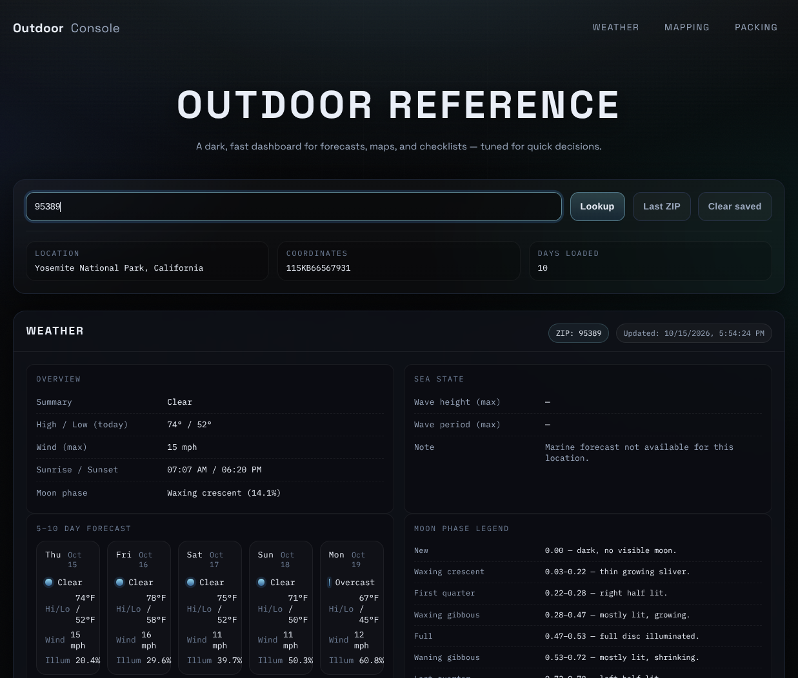
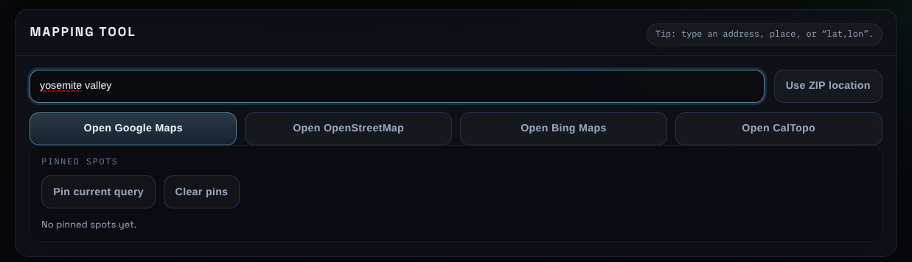
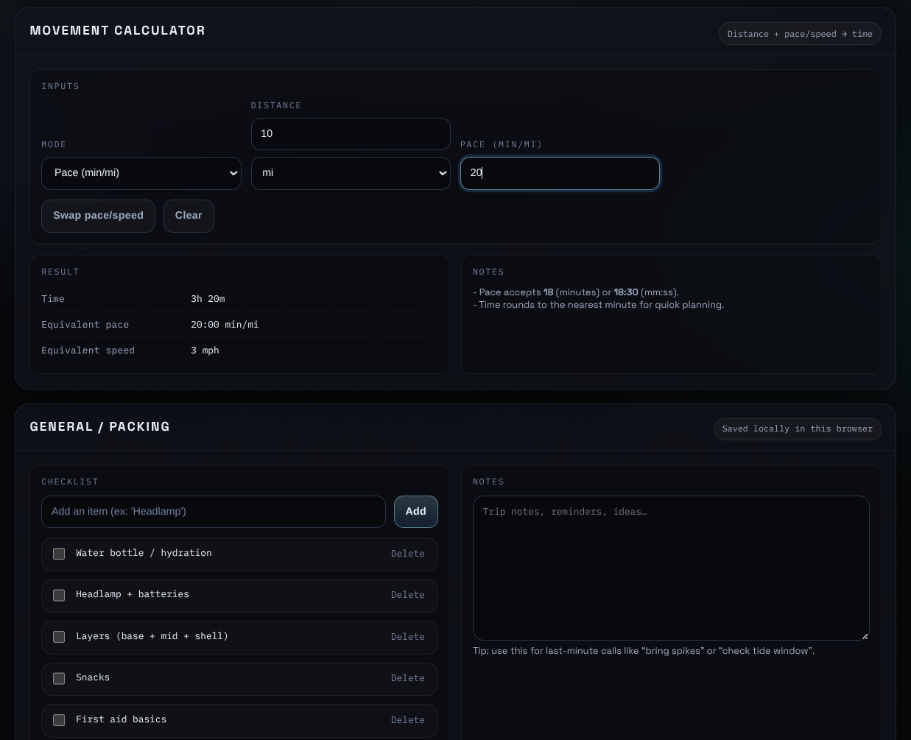

# Outdoor Console


A fast, dark, single-page dashboard for planning time outdoors — camping, backpacking, hiking, and hunting trips. Look up a forecast, open your spot in the mapping site you prefer, estimate movement time, and keep a packing checklist, all from one screen.

**Live demo:** https://bloodhound403.github.io/outdoor-console/



---

## Features

**Weather**
- Search by US ZIP code or place name (e.g. `Tahoe City`, `Springfield IL`)
- 10-day forecast: conditions, high/low (°F), and max wind (mph)
- Today's sunrise/sunset, moon phase, and moon illumination for each day
- Location shown as an MGRS grid reference

**Sea state**
- Max wave height (ft) and wave period (s) for coastal locations, when marine data is available

**Mapping**
- Send any address, place, or `lat,lon` to Google Maps, OpenStreetMap, Bing Maps, or CalTopo in one click
- Reuse the last looked-up location as the map query
- Pin up to 20 spots for quick access later

**Movement calculator**
- Distance (mi or km) plus pace (min/mi) or speed (mph) gives estimated travel time
- Converts between pace and speed with one button

**Packing**
- Checklist pre-filled with sensible defaults, plus free-form trip notes
- Saved in your browser; one button clears everything

## Screenshots

**Mapping tool** — send a search to Google Maps, OpenStreetMap, Bing Maps, or CalTopo, and pin spots for later.



**Movement calculator and packing** — estimate travel time and keep a checklist and trip notes.



## Quick start

No install, no build step, no API keys. You only need a way to serve static files.

```bash
git clone https://github.com/BloodHound403/outdoor-console.git
cd outdoor-console
python3 -m http.server 8000
```

Then open <http://localhost:8000>.

On Windows you can run `serve.cmd` or `serve.ps1` instead.

> **Why a local server?** The page fetches live forecast data. Opening `index.html` directly as a `file://` URL can cause some browsers to block those requests.

## Privacy

- No accounts, analytics, cookies, or tracking.
- Your checklist, notes, pins, and last location are stored only in your browser (`localStorage`) and never leave your device.
- To fetch a forecast, the ZIP code or place name you enter (and the resulting coordinates) are sent to the public APIs listed below.
- Fonts load from Google Fonts and the MGRS library loads from jsDelivr.
- The mapping buttons open third-party map sites in a new tab.

## Data sources and credits

| Service / library | Used for | Notes |
|---|---|---|
| [Open-Meteo](https://open-meteo.com/) | Forecast, marine, and place-name geocoding APIs | Free for non-commercial use; data licensed [CC BY 4.0](https://open-meteo.com/en/licence) |
| [Zippopotam.us](https://www.zippopotam.us/) | US ZIP code → coordinates | Free, no key |
| [mgrs](https://github.com/proj4js/mgrs) | Lat/lon → MGRS conversion | Loaded from jsDelivr |
| [Google Fonts](https://fonts.google.com/) | Space Grotesk and IBM Plex Mono | SIL Open Font License |

Moon phase and illumination are computed locally from the synodic cycle, not fetched from an API.

## Project structure

```
outdoor-console/
├── index.html     # Page layout and markup
├── styles.css     # Dark theme and responsive layout
├── app.js         # Data fetching, rendering, calculator, and local storage
├── serve.cmd      # Windows: start a local server
├── serve.ps1      # Windows PowerShell: start a local server
├── screenshots/   # Images used in this README
├── LICENSE
├── SECURITY.md
└── README.md
```

## Tech stack

Plain HTML, CSS, and JavaScript. No frameworks, bundlers, or dependencies to install.

## Disclaimer

Outdoor Console is a planning reference, not a safety tool. Always confirm forecasts with official sources such as the [National Weather Service](https://www.weather.gov/), and check local conditions, closures, and regulations before heading out.

## Contributing

Issues and suggestions are welcome. Please open an issue describing the bug or idea before submitting a pull request.

## License

Released under the [MIT License](LICENSE).
